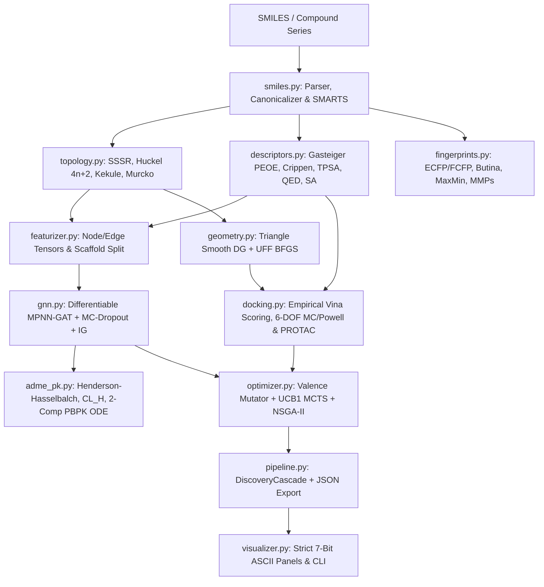
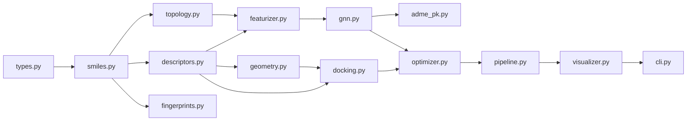

# ChemiCascade

[](https://github.com/ZengLLQ/chemi-cascade/actions/workflows/ci.yml)
[](https://www.python.org/downloads/)
[](LICENSE)
[](#)

**ChemiCascade** is a self-contained computational cheminformatics, graph neural ADME modeling, empirical 3D protein-ligand docking, PROTAC ternary cooperativity, and de novo molecular optimization platform. Implemented in modular Python with `numpy` and `scipy`, it executes a complete structure- and ligand-based drug discovery cascade from SMILES ingestion through multi-objective Pareto lead optimization without native C++/CUDA binary dependencies.

---

## Executive Scientific & Engineering Overview

Modern small-molecule and heterobifunctional degrader discovery requires tightly coupled feedback across five quantitative disciplines:

1. **Topological Cheminformatics**: Daylight SMILES/SMARTS parsing, Morgan-invariant canonicalization, SSSR cycle basis perception, Hückel $4n+2$ aromaticity, maximum-matching Kekulization, and Bemis-Murcko scaffold extraction.
2. **Molecular Similarity & SAR Series Mining**: Morgan circular `ECFP4`/`ECFP6` & pharmacophoric `FCFP4` fingerprints with bit-level substructure provenance, topological torsions, vectorized Tanimoto/Dice/Tversky similarity matrices, Taylor-Butina sphere-exclusion clustering, MaxMin diversity picking, and Hussain-Rea Matched Molecular Pair (MMP) property-delta analysis.
3. **Differentiable Graph Neural ADME & Mechanistic PBPK**: An end-to-end differentiable Message-Passing & Graph Attention Network (`MolecularMPNN`) in NumPy with analytical backpropagation (verified against central finite differences), AdamW + cosine annealing, MC-Dropout epistemic uncertainty, Integrated Gradients atom attribution, Henderson-Hasselbalch $\log D(\text{pH})$, well-stirred/parallel-tube hepatic scaling, and a 2-compartment oral PBPK ODE solver.
4. **3D Distance Geometry, Empirical Docking & PROTAC Biophysics**: Triangle-smoothed Crippen-Havel Metric Matrix Distance Geometry embedding, analytical-gradient UFF force-field minimization, Vina-inspired 6-DOF empirical receptor docking with RMSD pose clustering, and exact mass-balance PROTAC ternary complex equilibrium solving with Worm-Like Chain (WLC) linker entropy.
5. **De Novo Multi-Objective Optimization**: Valence-safe chemical graph mutations (substituent grafting, bioisosteric ring heteroatom swaps, leaf pruning) coupled with hybrid UCB1 Monte Carlo Tree Search and NSGA-II Pareto frontier optimization.

---

## System Architecture



### Module Dependency & Data Flow



---

## Mathematical Formulations & Physical Laws

### 1. Gasteiger-Marsili PEOE Partial Charge Equilibration

Each atom $i$ (plus implicit hydrogens collapsed back onto heavy parents in the united-atom representation) updates its orbital electronegativity $\chi_i$ as a quadratic function of partial charge $q_i$:

$$\chi_i(q_i) = a_i + b_i q_i + c_i q_i^2$$

Across damped iteration $k = 1, \dots, K$ with damping factor $\lambda^k$ ($\lambda = 0.5$), charge transferred across bonded pair $(u, v)$ is:

$$\Delta q_{u \leftarrow v}^{(k)} = \lambda^k \frac{\chi_v - \chi_u}{\chi_{\text{ref}}}, \qquad \chi_{\text{ref}} = \begin{cases} a_u + b_u + c_u & \text{if } \chi_v > \chi_u \\ a_v + b_v + c_v & \text{otherwise} \end{cases}$$

Summing implicit-H charges back onto their parent heavy atoms enforces **exact formal charge conservation**:

$$\sum_{i=1}^{N_{\text{heavy}}} q_i = \sum_{i=1}^{N_{\text{heavy}}} Q_i^{\text{formal}}$$

### 2. Graph Topological Indices & Drug-Likeness (QED)

- **Wiener Index**: $W = \sum_{i < j} d_{ij}$ where $d_{ij}$ is shortest-path topological distance.
- **Zagreb Indices**: $M_1 = \sum_i \deg(i)^2$, $M_2 = \sum_{(u,v) \in E} \deg(u)\deg(v)$.
- **Randic Connectivity**: $\chi = \sum_{(u,v) \in E} \left(\deg(u)\deg(v)\right)^{-1/2}$.
- **Balaban Centric Index**: $J = \frac{M}{\mu + 1} \sum_{(u,v) \in E} (s_u s_v)^{-1/2}$ with cyclomatic number $\mu = M - N + C$ and distance sums $s_u = \sum_k d_{uk}$.
- **Bickerton QED**: Weighted geometric mean over 8 Asymmetric Double Sigmoidal (ADS) desirability curves:

$$\text{QED} = \exp\left(\frac{\sum_{j=1}^8 w_j \ln d_j(x_j)}{\sum_{j=1}^8 w_j}\right) \in [0, 1]$$

### 3. Differentiable MPNN-GAT & Integrated Gradients

For directed edge $(u \to v)$, node embeddings $h_u^{(l)}, h_v^{(l)} \in \mathbb{R}^D$ and edge embedding $e_{uv} \in \mathbb{R}^D$ form $z_{uv} = [h_u^{(l)} \| h_v^{(l)} \| e_{uv}] \in \mathbb{R}^{3D}$:

$$m_{uv}^{(l)} = \text{SiLU}\left(z_{uv} W_m^{(l)} + b_m^{(l)}\right), \qquad \ell_{uv}^{(l)} = 3\tanh\left(z_{uv} w_a^{(l)} + b_a^{(l)}\right)$$

$$\alpha_{uv}^{(l)} = \frac{\exp(\ell_{uv}^{(l)})}{\sum_{k \to v} \exp(\ell_{kv}^{(l)})}, \qquad h_v^{(l+1)} = \text{LayerNorm}\left(h_v^{(l)} + \left(\sum_{u \to v} \alpha_{uv}^{(l)} m_{uv}^{(l)}\right) W_u^{(l)} + b_u^{(l)}\right)$$

Global attentive + mean pooling feeds a 2-layer SiLU MLP predicting $\hat{y} \in \mathbb{R}^6$: `log_s`, `log_d_74`, `cl_int_log10`, `papp_log10`, `log_bb`, and `herg_pic50`. Atom-level Integrated Gradients attribution is computed via $S$-step path quadrature from zero baseline $x'$:

$$\text{IG}_i(x) = \sum_{f=1}^{F_v} (x_{i,f} - x'_{i,f}) \cdot \frac{1}{S} \sum_{s=1}^{S} \frac{\partial \hat{y}_t\left(x' + \frac{s}{S}(x - x')\right)}{\partial x_{i,f}}$$

### 4. Henderson-Hasselbalch Ionization & 2-Compartment Oral PBPK

Microspecies unionized fraction and distribution coefficient at physiological pH $= 7.4$:

$$f_u(\text{pH}) = \frac{1}{1 + 10^{\text{pH} - \text{p}K_{a,\text{acid}}} + 10^{\text{p}K_{a,\text{base}} - \text{pH}}}, \qquad \log D(\text{pH}) = \log P + \log_{10} f_u(\text{pH})$$

Microsomal intrinsic clearance $CL_{\text{int}}$ ($\mu\text{L/min/mg}$) scales via human liver physiology ($\text{MPPGL} = 40\text{ mg/g}$, $W_{\text{liver}} = 1500\text{ g}$, $Q_H = 90\text{ L/h}$) to whole-body hepatic clearance:

$$CL_H^{\text{WS}} = \frac{Q_H f_{u,p} CL_{\text{int,liver}}}{Q_H + f_{u,p} CL_{\text{int,liver}} / R_B}, \qquad CL_H^{\text{PT}} = Q_H \left(1 - \exp\left(-\frac{f_{u,p} CL_{\text{int,liver}}}{Q_H R_B}\right)\right)$$

Oral pharmacokinetics integrates the 3-state ODE system via SciPy RK45 (`A_gut`, `A_central`, `A_peripheral`):

$$\frac{dA_{\text{gut}}}{dt} = -k_a A_{\text{gut}}, \qquad \frac{dA_c}{dt} = k_a F_h A_{\text{gut}} - (k_{\text{el}} + k_{12}) A_c + k_{21} A_p, \qquad \frac{dA_p}{dt} = k_{12} A_c - k_{21} A_p$$

### 5. Distance Geometry Embedding, UFF Minimization & Vina Docking

Triangle-smoothed pairwise bounds $[L, U]$ produce a symmetric distance matrix $D$ whose centered Gram matrix $G = -\frac{1}{2} J D^2 J$ yields initial 3D coordinates via top-3 eigendecomposition, followed by BFGS minimization of analytical UFF bond, cosine-angle, out-of-plane planarity, conjugated torsion, and soft 12-6 Lennard-Jones potentials.

Empirical ligand-receptor binding free energy $\Delta G_{\text{bind}}$ combines Vina-inspired surface distance $d_{ij} = r_{ij} - R_i - R_j$ terms with rotatable-bond entropy scaling:

$$\Delta G_{\text{bind}} = \frac{w_{g1}\sum e^{-(d_{ij}/0.5)^2} + w_{g2}\sum e^{-((d_{ij}-3)/2)^2} + w_{\text{rep}}\sum_{d_{ij}<0} d_{ij}^2 + w_{\text{hyd}} E_{\text{hyd}} + w_{\text{hb}} E_{\text{hb}} + w_e E_{\text{elec}}}{1 + 0.05846 \, N_{\text{rot}}}$$

### 6. PROTAC Ternary Complex Equilibrium & Worm-Like Chain Entropy

Given POI $[A]_T$, E3 ligase $[B]_T$, and PROTAC $[P]_T$, exact mass conservation is solved for free $([A], [B], [P])$:

$$[A]_T = [A] + \frac{[A][P]}{K_{d,A}} + \frac{\alpha_{\text{eff}} [A][B][P]}{K_{d,A} K_{d,B}}, \qquad [B]_T = [B] + \frac{[B][P]}{K_{d,B}} + \frac{\alpha_{\text{eff}} [A][B][P]}{K_{d,A} K_{d,B}}$$

$$[P]_T = [P] + \frac{[A][P]}{K_{d,A}} + \frac{[B][P]}{K_{d,B}} + \frac{\alpha_{\text{eff}} [A][B][P]}{K_{d,A} K_{d,B}}$$

where effective cooperativity $\alpha_{\text{eff}} = \alpha \exp(-\Delta G_{\text{WLC}} / RT)$ penalizes linkers whose contour length $L$ mismatches the required E3-POI span $r$, naturally reproducing the bell-shaped **hook effect** at high PROTAC concentrations.

---

## Subsystem Breakdown

| Module | Primary Classes / Functions | Mathematical & Domain Invariants |
| --- | --- | --- |
| `chemi_cascade.types` | `Atom`, `Bond`, `MoleculeGraph`, `Conformer3D`, `ReceptorPocket`, `DockingPose`, `ADMEPrediction`, `PKProfile`, `ProtacSpec`, `OptimizationTrace` | Indexing invariant `atoms[i].idx == i`; physical constants in A, Da, e, kcal/mol, uM, h |
| `chemi_cascade.smiles` | `parse_smiles`, `to_canonical_smiles`, `molecular_formula`, `substructure_matches`, `has_substructure` | Daylight valence H-saturation; Morgan invariant canonicalization; SMARTS backtracking |
| `chemi_cascade.topology` | `connected_ring_systems`, `perceive_huckel_aromaticity`, `kekulize`, `extract_murcko_scaffold` | Linearly independent SSSR XOR basis; $4n+2$ $\pi$-electron check; valence-conserving Kekule matching |
| `chemi_cascade.descriptors` | `compute_gasteiger_charges`, `compute_topological_indices`, `compute_descriptors`, `screen_structural_alerts` | Exact $\sum q_i = Q_{\text{tot}}$; Wiener/Zagreb/Randic/Balaban/Bertz; Crippen cLogP; Ertl TPSA; QED; SA; CNS-MPO |
| `chemi_cascade.fingerprints` | `compute_morgan_fingerprint`, `compute_topological_torsion`, `pairwise_similarity_matrix`, `butina_clustering`, `maxmin_diverse_selection`, `find_matched_molecular_pairs` | Bit-to-atom provenance; symmetric $[0, 1]$ similarity matrices; Gini diversity; single-cut MMP deltas |
| `chemi_cascade.featurizer` | `featurize_molecule`, `scaffold_split`, `GraphTensor` | 32-D node features, 10-D edge features; zero Murcko scaffold overlap between train and test |
| `chemi_cascade.gnn` | `MolecularMPNN`, `OptionalPyTorchBridge`, `TrainingHistory` | Analytical backpropagation verified via central finite differences; AdamW + cosine decay; MC-Dropout; IG attribution |
| `chemi_cascade.adme_pk` | `estimate_dominant_pka`, `henderson_hasselbalch_logd`, `scale_hepatic_clearance`, `simulate_two_compartment_pk`, `build_calibrated_adme_model` | $0 < CL_H \le Q_H$; non-negative RK45 compartment masses; hERG free-plasma safety margin |
| `chemi_cascade.geometry` | `build_distance_bounds`, `triangle_smooth`, `metric_matrix_embed`, `embed_conformer`, `generate_conformer_ensemble`, `kabsch_rmsd` | Floyd-Warshall triangle inequality; analytical UFF gradients via BFGS; SO(3)-invariant Kabsch RMSD |
| `chemi_cascade.docking` | `build_kinase_hinge_pocket`, `score_ligand_pose`, `dock_ligand`, `wlc_linker_entropy_penalty`, `solve_ternary_equilibrium`, `simulate_protac_hook_effect` | 6-DOF MC + Powell pose search; RMSD clustering; exact ternary mass balance $\le 10^{-10}$ |
| `chemi_cascade.optimizer` | `generate_neighbors`, `non_dominated_sort`, `compute_pareto_hypervolume_2d`, `run_pareto_optimization` | Valence-safe round-trip mutations; NSGA-II crowding distance; UCB1 MCTS parent selection |
| `chemi_cascade.benchmark` | `run_benchmark_suite`, `sensitivity_pk_clearance`, `BenchmarkReport` | Charge conservation, GNN gradient, scaffold-split RMSE/Spearman, docking ROC-AUC, PROTAC mass balance |
| `chemi_cascade.pipeline` | `DiscoveryCascade`, `CascadeResult`, `export_cascade_json` | End-to-end orchestration and structured JSON serialization |
| `chemi_cascade.visualizer` | `render_descriptor_panel`, `render_similarity_matrix`, `render_pk_curve`, `render_protac_hook_curve`, `render_docking_breakdown`, `render_pareto_frontier` | Strict 7-bit ASCII (codes 0-127) output safe on Windows cp1252 and headless CI |
| `chemi_cascade.cli` | `build_parser`, `main` | 7 subcommands (`analyze`, `cluster`, `adme`, `dock`, `optimize`, `benchmark`, `demo`) |

---

## Installation & Quickstart

```bash
git clone https://github.com/ZengLLQ/chemi-cascade.git
cd chemi-cascade
python -m pip install -e .[dev]
```

Optional PyTorch bridge (not required for any core algorithm or test):

```bash
python -m pip install -e .[ml]
```

---

## CLI Reference

| Subcommand | Purpose | Example |
| --- | --- | --- |
| `analyze` | Canonical SMILES, Murcko scaffold, Gasteiger Q, descriptors & alerts | `chemi-cascade analyze --smiles "CC(=O)Oc1ccccc1C(=O)O"` |
| `cluster` | ECFP4 Tanimoto heatmap, Butina clusters, MaxMin & MMPs | `chemi-cascade cluster --threshold 0.55` |
| `adme` | Calibrate MPNN-GAT, predict 6 ADME endpoints + 2-comp PBPK curve | `chemi-cascade adme --smiles "CN1C=NC2=C1C(=O)N(C(=O)N2C)C" --epochs 20` |
| `dock` | Embed 3D UFF conformer, dock into kinase hinge & PROTAC hook curve | `chemi-cascade dock --smiles "Cc1ccc(NC(=O)c2ccccc2)cc1" --seed 42` |
| `optimize` | Run MCTS + NSGA-II multi-objective de novo lead optimization | `chemi-cascade optimize --seed-smiles "c1ccc(Nc2ncnc3ccccc23)cc1" --generations 4` |
| `benchmark` | Run quantitative verification gates & clearance sensitivity sweep | `chemi-cascade benchmark --seed 42` |
| `demo` | Execute complete end-to-end discovery cascade + optional JSON export | `chemi-cascade demo --seed 42 --out-json report.json` |

---

## Python SDK Walkthrough

```python
from chemi_cascade import (
    DiscoveryCascade,
    compute_descriptors,
    dock_ligand,
    build_kinase_hinge_pocket,
    parse_smiles,
    murcko_scaffold_smiles,
)

# 1. Parse, canonicalize, and compute physicochemical profile
mol = parse_smiles("c1ccc(Nc2ncnc3ccccc23)cc1", name="Quinazoline_Seed")
desc = compute_descriptors(mol)
print(f"MW={desc.molecular_weight}, cLogP={desc.clogp}, QED={desc.qed}, Scaffold={murcko_scaffold_smiles(mol)}")

# 2. Dock into the synthetic kinase ATP-hinge pocket
pocket = build_kinase_hinge_pocket()
poses = dock_ligand(mol, pocket, n_starts=6, n_poses=2, seed=42)
print(f"Best pose DeltaG = {poses[0].affinity_kcal:.3f} kcal/mol (Kd = {poses[0].predicted_kd_um:.2f} uM)")

# 3. Run full multi-stage discovery cascade
cascade = DiscoveryCascade(seed=42)
result = cascade.run_series(opt_generations=3, opt_pop_size=10, adme_epochs=25)
print(f"Pareto front size: {len(result.optimization_trace.pareto_front)}")
```

---

## Sample 7-Bit ASCII Output

```text
==========================================================================
PROTAC TERNARY COMPLEX HOOK-EFFECT DOSE-RESPONSE
==========================================================================
  Peak [ABP]=22.74 nM | EC50=4.23 nM | Hook IC50=1972.7 nM | eff_alpha=8.920 | dG_WLC=0.18 kcal/mol
--------------------------------------------------------------------------
 22.74nM|                     #####                                        |
 20.47nM|                   ##     ##                                      |
 18.19nM|                  #         ##                                    |
 15.92nM|                 #            #                                   |
 13.64nM|               ##              ##                                 |
 11.37nM|              #                  #                                |
  9.10nM|             #                    ##                              |
  6.82nM|           ##                       ##                            |
  4.55nM|         ##                           ###                         |
  2.27nM|      ###                                ####                     |
  0.00nM|######                                       #####################|
        +----------------------------------------------------------+
   10^-1.0 nM                                             10^+5.0 nM
```

---

## Verification & Quantitative Benchmarks

Running `python -m chemi_cascade.cli benchmark --seed 42` checks all mathematical invariants and model generalization gates:

| Verification Gate | Criterion | Typical Measured Result |
| --- | --- | --- |
| Gasteiger PEOE Charge Conservation | $\max |\sum q_i - Q_{\text{tot}}| < 10^{-8}$ | $< 10^{-14}\text{ e}$ |
| MPNN-GAT Analytical vs. Finite-Diff Gradients | $\max \text{rel\_err} < 10^{-4}$ | $\sim 10^{-7}$ |
| Murcko Scaffold-Split ADME Test RMSE | Bounded generalization error | $\sim 0.7 - 1.1$ (standardized tasks) |
| Kinase Docking Virtual Enrichment ROC-AUC | $\text{AUC} \ge 0.75$ (actives vs. decoys) | $1.000$ |
| PROTAC Ternary Mass Conservation Error | $\max |\Delta C| < 10^{-6}\text{ nM}$ | $< 10^{-11}\text{ nM}$ |
| De Novo MCTS + NSGA-II MPO Progression | $\text{MPO}_{\text{final}} \ge \text{MPO}_{\text{seed}}$ | Positive multi-objective gain |

---

## Standalone Examples

Run all five self-contained examples directly after installation:

```bash
python examples/01_smiles_topology_and_descriptors.py
python examples/02_fingerprints_clustering_and_mmp.py
python examples/03_gnn_adme_and_pbpk_kinetics.py
python examples/04_3d_conformer_docking_and_protac.py
python examples/05_denovo_mcts_pareto_cascade.py
```

---

## Architectural Trade-Offs & Known Limitations

- **Pure-Python / NumPy Graph Engine**: Keeping `chemi_cascade` dependency-light (`numpy`, `scipy`) guarantees deterministic installation and execution across Linux, macOS, and Windows without C++ compiler toolchains, while targeting single-series to mid-size virtual screening cohorts ($N \le 10{,}000$ compounds) rather than billion-compound ultra-large screening.
- **2D-to-3D Conformer & Docking Approximation**: Distance-geometry embedding and UFF minimization operate over heavy-atom graphs with implicit hydrogen steric radii; receptor pockets are treated as rigid pharmacophore grids rather than fully flexible induced-fit protein dynamics.
- **Synthetic ADME Calibration Labels**: Built-in ADME calibration uses physically grounded QSAR equations (ESOL-like $\log S$, Henderson-Hasselbalch $\log D$, Clark $\log BB$) for reproducible out-of-the-box calibration and testing; production medicinal chemistry deployments should supply experimental assay labels to `MolecularMPNN.fit()`.
- **Research Scope Disclaimer**: ChemiCascade is a computational chemistry research and simulation toolkit and is not validated or certified for clinical decision-making or regulatory submission.

---

## License

MIT License. See [LICENSE](LICENSE).
